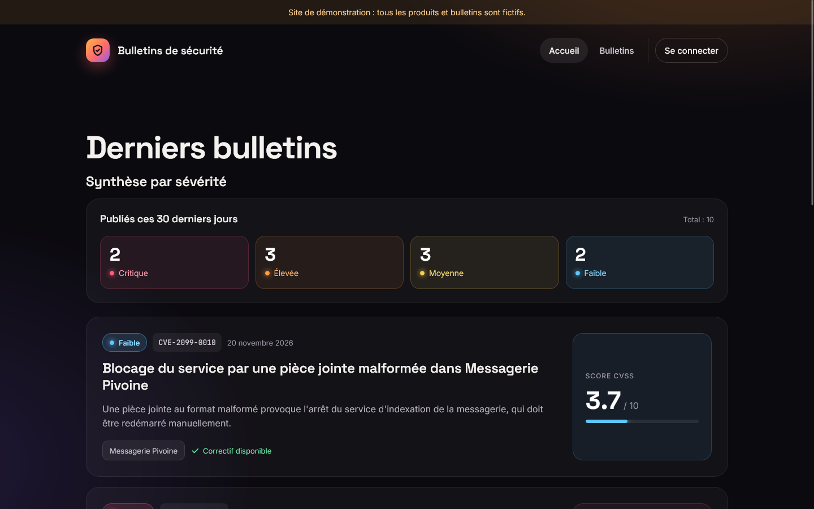
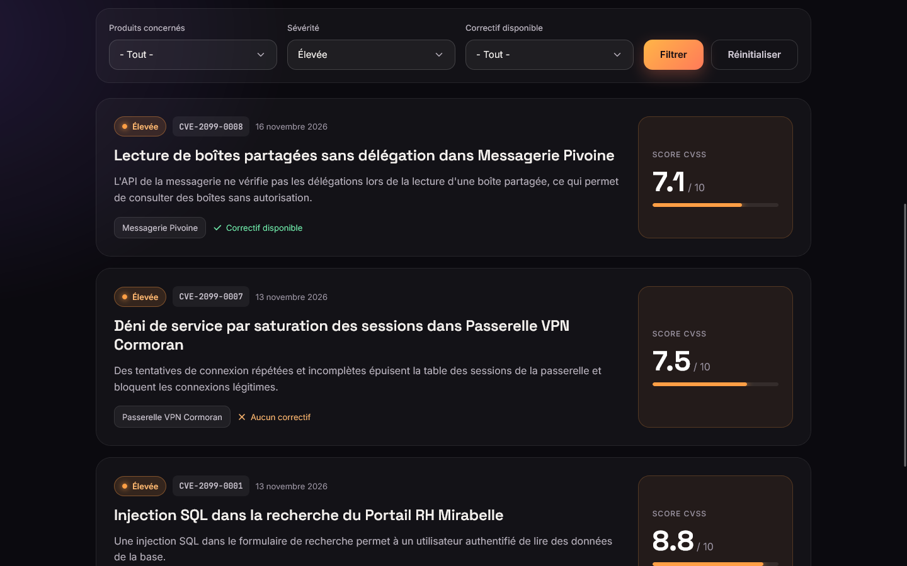
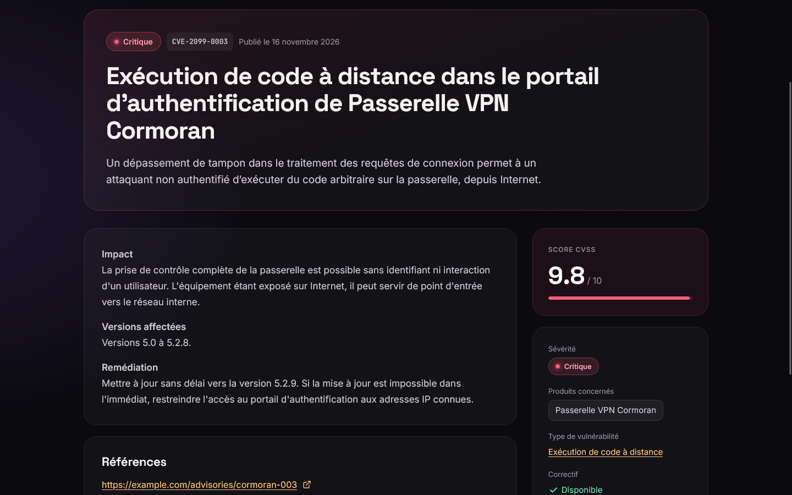
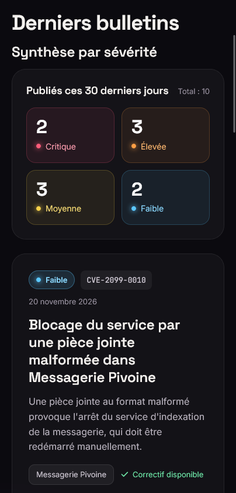
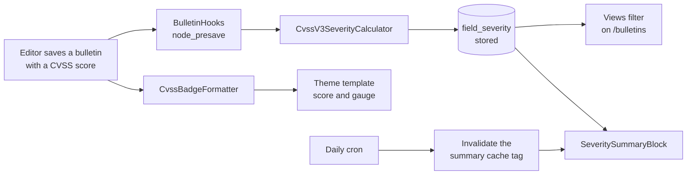

# Drupal Security Bulletins

[](https://github.com/audreyantony/drupal-security-bulletins/actions/workflows/ci.yml)


A Drupal 11 portal where a security team publishes vulnerability bulletins. Authors write them, reviewers approve them, and visitors browse and filter them by product, severity and fix status.

Built as a learning project by a Symfony developer moving to Drupal. All products and bulletins are fictional.



> **En bref (FR)** : portail de bulletins de sécurité sous Drupal 11. Les rédacteurs écrivent, les validateurs publient, et les visiteurs filtrent les bulletins par produit, sévérité et disponibilité d'un correctif. Thème sombre sur mesure, module développé pour l'occasion, tests automatisés et contrôles de sécurité à chaque push. Projet d'apprentissage : tout le contenu est fictif.

## Features

- **Content model**: bulletin content type with CVSS score, severity, CVE identifier, affected products, vulnerability type, fix status and references.
- **Editorial workflow**: authors draft and submit, reviewers publish and archive. Publishing always requires a review.
- **Listing**: filterable by product, severity and fix status, with an RSS feed and readable URLs.
- **Severity summary**: counts of recent bulletins by severity; each tile links to the filtered listing.
- **Custom dark theme** generated with Starterkit: Twig templates, self-hosted fonts, French interface translations. Lighthouse accessibility score of 100 on the main pages; keyboard navigation checked manually.
- **Security baseline**: audit trail, Content Security Policy and other security headers, registration closed to visitors.

| Filtered listing | Bulletin page |
| --- | --- |
|  |  |


| Mobile view |
| --- |
|  |

## Installation

Requirements: Docker and [DDEV](https://ddev.com).

```bash
git clone https://github.com/audreyantony/drupal-security-bulletins.git
cd drupal-security-bulletins
ddev start
ddev composer install
ddev drush site:install --existing-config -y
ddev drush security-bulletin:demo-content -y
ddev launch
```

Log in as administrator with `ddev drush user:login`.

## Architecture

The site is built mostly by configuration (`config/sync`). Custom code covers only what core and contributed modules do not.



| Path | Content |
| --- | --- |
| `config/sync` | Exported site configuration: content model, workflow, roles, views, blocks |
| `web/modules/custom/security_bulletin` | Custom module: severity calculator, hooks, formatter, block, Drush command, tests |
| `web/themes/custom/bulletin_theme` | Custom theme: templates, CSS, fonts, French translations |
| `scripts/smoke-test.sh` | HTTP checks of the installed site |
| `.github/workflows/ci.yml` | Continuous integration |

### Contributed modules

| Module | Why |
| --- | --- |
| Admin Toolbar | Faster navigation in the administration |
| Pathauto | Readable URLs for bulletins and taxonomy terms |
| Admin Audit Trail | Logs logins, account, role and content changes |
| Security Kit | Content Security Policy and other security headers |

Each one was checked for Drupal 11 compatibility, recent releases and security advisory coverage before being added.

## Technical choices

- **Contributed modules first.** Audit logging and security headers already exist as maintained modules; writing them again would add code to maintain and review.
- **Severity is stored, not computed on display**, so Views can filter on it. A `node_presave` hook keeps it in sync with the score.
- **The calculator sits behind an interface.** `CvssV3SeverityCalculator` implements the CVSS v3 scale; supporting CVSS v4 would mean adding a second implementation, not changing callers.
- **The module provides data, the theme provides the look.** The formatter and the block declare neutral templates; the theme overrides them.
- **Theme generated with Starterkit**, which copies base templates instead of inheriting them: core updates cannot change the rendering.
- **Cache handled explicitly.** The summary block depends on bulletin changes (`node_list:bulletin`) and on time. Drupal's anonymous page cache ignores time-based expiry, so a dedicated cache tag is invalidated once a day by cron.
- **Hooks as classes** (`#[Hook]`, Drupal 11.1+) and dependency injection everywhere, which makes the code testable.

## Security

- Authors cannot publish: every bulletin goes through a reviewer. This rule is covered by a kernel test that reads the real exported workflow and roles.
- Restricted text format for bulletin content, Twig autoescaping never bypassed.
- Content Security Policy with scripts limited to the site itself, clickjacking protection, strict referrer policy.
- Audit trail of logins, account, role and content changes, readable by reviewers only.
- Visitor registration closed.
- `composer audit` runs on every push. It has already blocked the build twice for real advisories (Drupal core SA-CORE-2026-017 and SA-CORE-2026-018, then Twig), each fixed in a dedicated commit.

## Quality

Every push runs, in DDEV:

| Check | Command |
| --- | --- |
| Coding standards (Drupal, DrupalPractice) | `ddev exec vendor/bin/phpcs` |
| Static analysis (PHPStan level 6, phpstan-drupal) | `ddev exec vendor/bin/phpstan analyse --memory-limit=1G` |
| 11 unit and 12 kernel tests | `ddev exec vendor/bin/phpunit` |
| Install from configuration, then check that it matches `config/sync` | see `.github/workflows/ci.yml` |
| Demo content generation and 11 smoke tests | `./scripts/smoke-test.sh` |

The kernel tests build the content model, workflow and roles from `config/sync`, so a configuration change that breaks a rule fails the build.

PHPStan ignores two error types that Drupal's own APIs cannot satisfy: untyped arrays (`missingType.iterableValue`) and unspecified generics (`missingType.generics`).

## Known limitations

- The Content Security Policy blocks an inline script of the core Navigation module in the administration, which can make the sidebar flicker on load. Options: allow that script by its hash, or replace Security Kit with the CSP module, which handles core inline scripts.
- The legal notice page contains placeholders to fill in before going online.
- No public demo yet.
- Ideas for later: CVE format validation, email alerts for critical bulletins, full-text search.

## How this was built

Built with the help of an AI assistant for guidance and code review; every change was run, tested and committed by me.

## License

GPL-2.0-or-later, like Drupal.